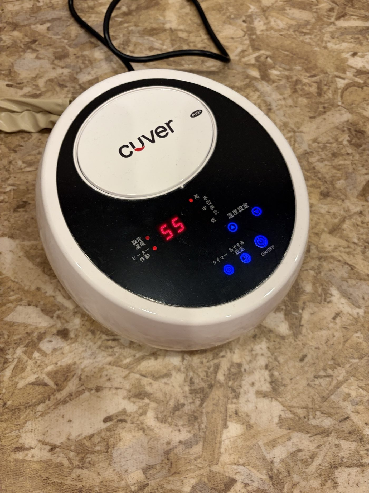
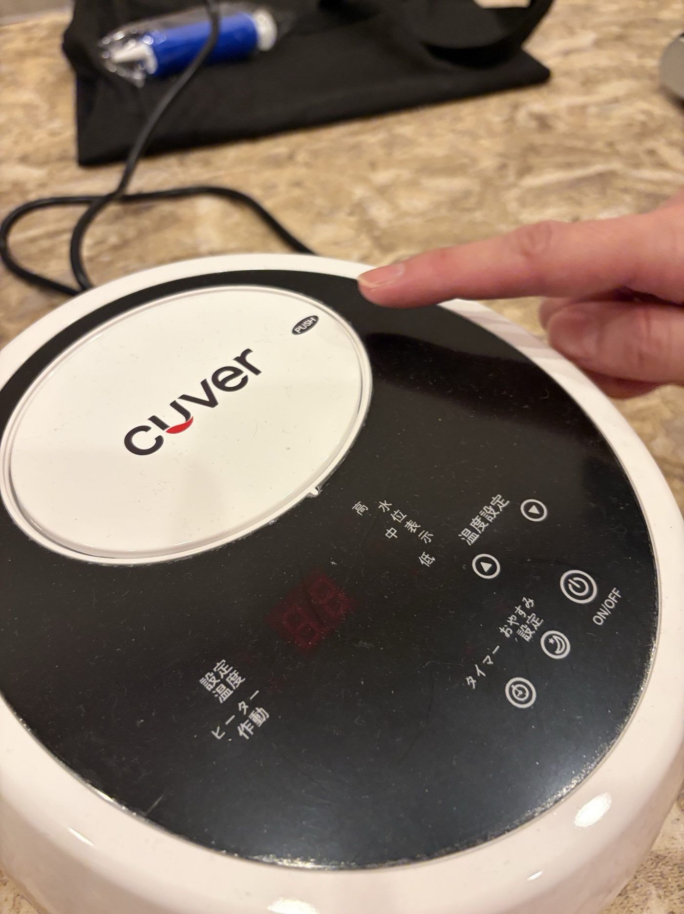
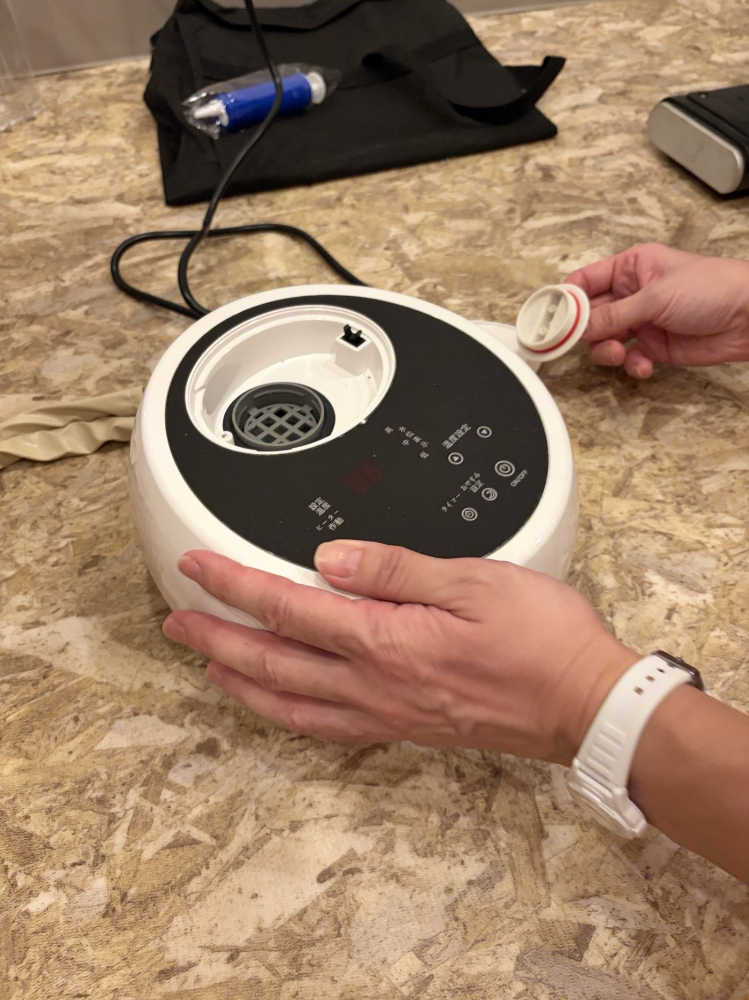

# リセナ立ち上げ

| 項目 | 内容 |
| --- | --- |
| 業務名 | リセナ立ち上げ |
| 実施時刻 | 8:30まで（温まるまで30分かかるため） |
| 様式 | A4 両面1枚 |
| 改訂日 | 2026-10-23 |

> 印刷用PDF：[リセナ立ち上げ.pdf](リセナ立ち上げ.pdf)（A4 両面1枚）

---

## 表面　リセナ立ち上げ

> ⏰ **温まるまでに30分かかるため、**8:30まで**に実施する。**

1. コンセントを差し込み、**電源ON**ボタンを押す。
2. 温度設定を**55℃**にする。

> ⚠️ 立ち上げた際に「水位表示」ランプが**低**になっていたら、**裏面の給水作業**を実施する。

---

## 裏面　給水作業

ベッド近くのペットボトルから水を足す。**専用水または水道水のみ**使用可能。

1. ロゴ中央の**PUSH**ボタンを押し、フタを開ける。

2. ペットボトルから給水する。

> ⚠️ 灰色カバーの網目から**溢れない程度**まで給水する。

> ⚠️ 溢れた際は**水色のスポイト**で水を戻す。故障の恐れがあるので、溢れたまま運転しないこと。
