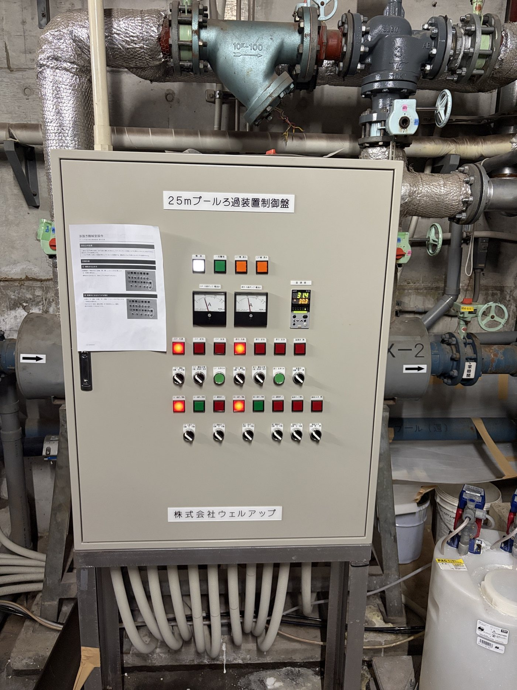
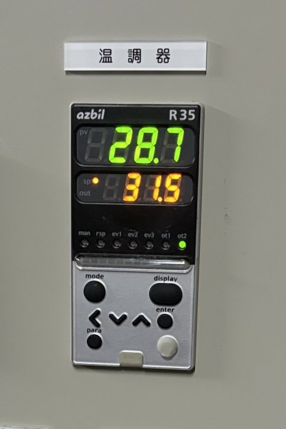
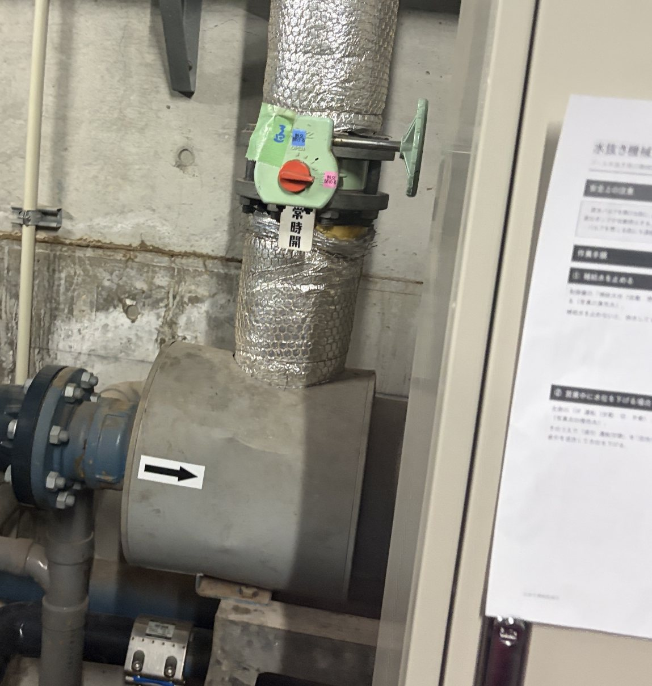
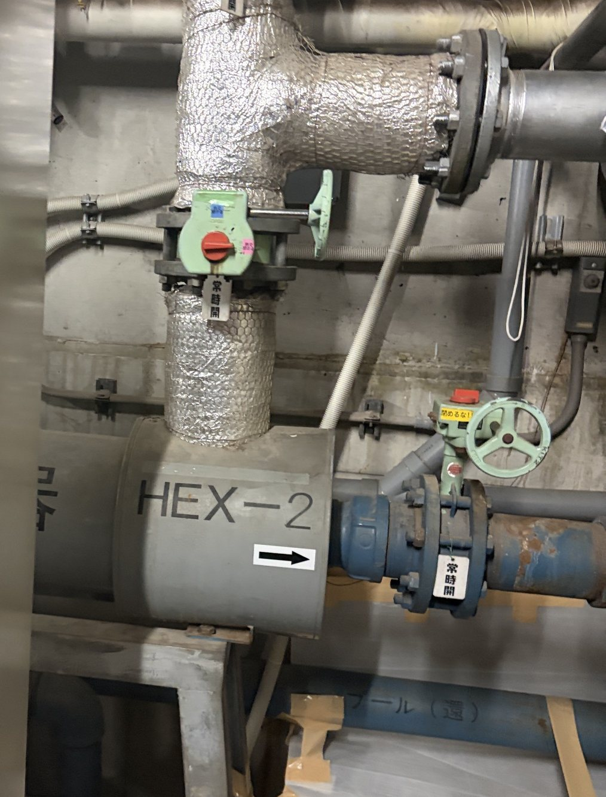
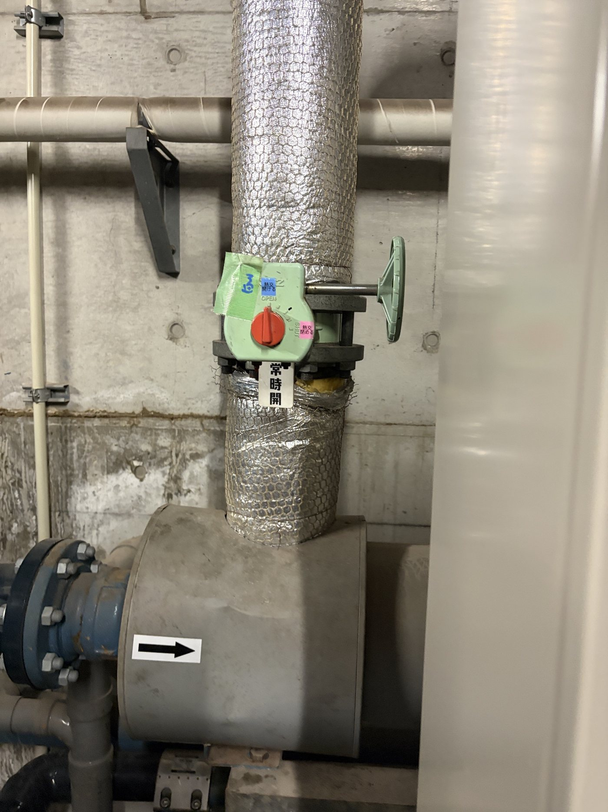
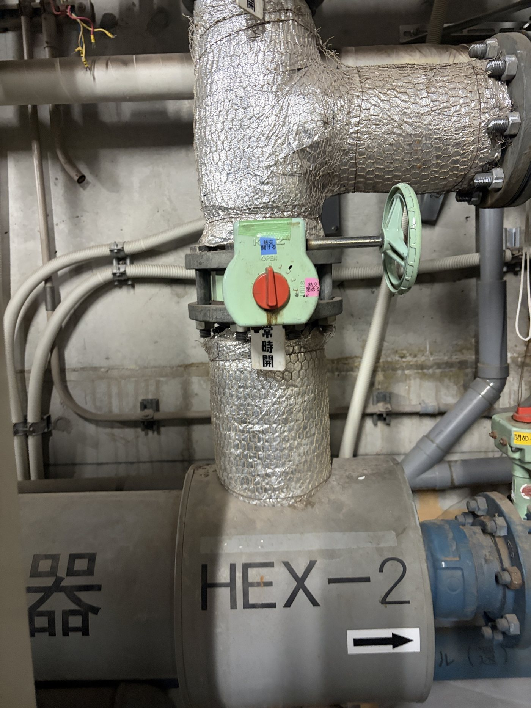

# 冬季熱交換器操作

| 項目 | 内容 |
| --- | --- |
| 作業名 | 冬季熱交換器操作 |
| 対象設備 | 25mプール 熱交換器（HEX-2）／制御盤裏 バルブ①② |
| プール理想温度 | 30.5℃ |
| 管理範囲 | 30.3℃〜30.8℃ |
| 適用 | 2026年11月時点（熱交換器不良による暫定運用） |
| 改訂日 | 2026-11-14 |

> 印刷用PDF：[冬季熱交換器操作.pdf](冬季熱交換器操作.pdf)

---

## 1. 目的

熱交換器の不良により自動制御だけでは水温が保てないため、プール水温が30.3℃〜30.8℃に収まるよう、制御盤裏のバルブ①②を手動で開閉して調整する。理想温度は30.5℃。

## 2. 安全上の注意

> ⚠️ **バルブを【閉】のまま終業することは絶対にしない。**翌日の水温回復に朝から夕方までかかり、ガスを通常以上に使用する。
>
> ⚠️ 本手順は熱交換器の不良による暫定運用（2026年11月時点）。修理後は手順を見直すこと。

---

## 3. 作業手順

### 手順① 操作場所の確認

「25mプールろ過装置制御盤」の**裏側**に、熱交換器（HEX-2）のバルブ①②がある。
温度の確認は制御盤おもて面の温調器で行う。

---

### 手順② 温度を確認する

**緑の数値**＝現在のプール水温。**オレンジの数値**＝設定値。
日中は緑の数値、またはプールの実測値で判断する。
※写真は読み取り位置を示すもので、適正値の例ではない。

---

### 手順③ 温度が高い場合　バルブ① 閉

緑の数値またはプール実測値が**30.8℃以上**の場合に実施する。
バルブ①を**【閉】**にする。
赤い指針がピンクのラベル「熱交&nbsp;閉める」側＝【閉】。

---

### 手順④ 温度が高い場合　バルブ② 閉

バルブ②も同様に**【閉】**にする。①②の両方を閉じること。

---

### 手順⑤ 温度が低い場合　バルブ① 開

緑の数値またはプール実測値が**30.3℃以下**の場合に実施する。
バルブ①を**【開】**にする。
赤い指針が青のラベル「熱交&nbsp;開ける（OPEN）」側＝【開】。

---

### 手順⑥ 温度が低い場合　バルブ② 開

バルブ②も同様に**【開】**にする。①②の両方を開けること。

---

### 手順⑦ 夜間（締め時確認作業）

温調器の**オレンジの数値**が**30.3〜30.5**になっていることを確認する（外気温により変動あり）。
バルブ①②を**【開】**にして終業する。
**閉のまま終業することは絶対NG。**

---

## 4. 作業完了後の確認

- [ ] 日中、緑の数値またはプール実測値が30.3〜30.8℃に収まっている
- [ ] 30.8℃以上のとき、バルブ①②を【閉】にした
- [ ] 30.3℃以下のとき、バルブ①②を【開】にした
- [ ] 締め時、オレンジの数値が30.3〜30.5であることを確認した
- [ ] 締め時、バルブ①②を【開】にして終業した

## 5. 実施記録

| 実施日 | 実施者 | 朝の水温 | 日中の操作 | 締め時の水温 | 特記事項 |
| --- | --- | --- | --- | --- | --- |
|  |  |  |  |  |  |
