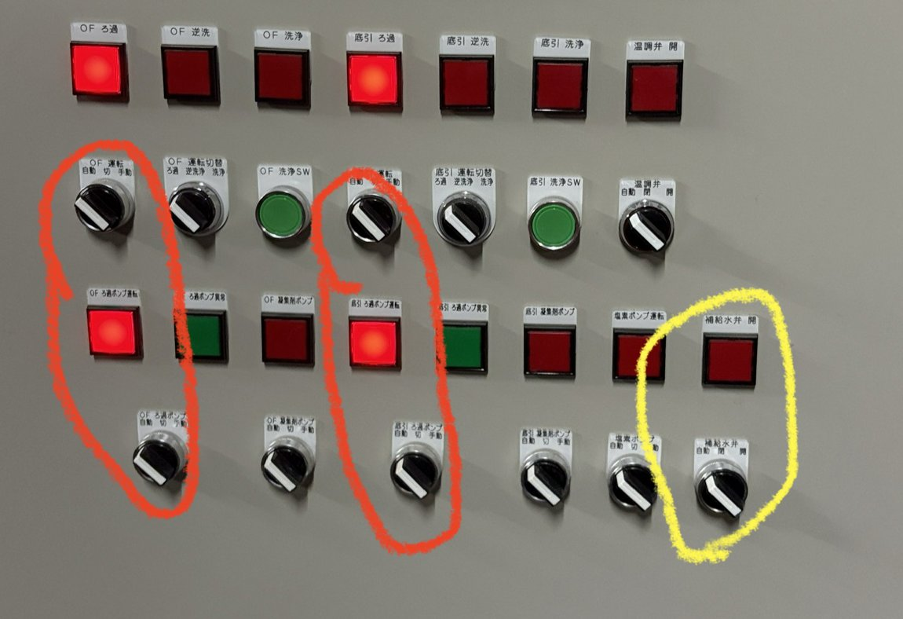
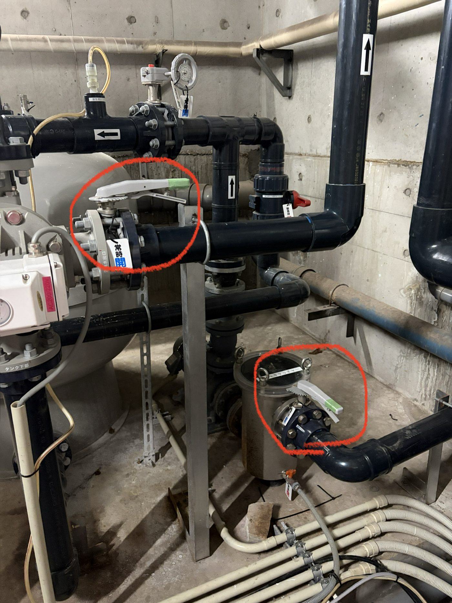
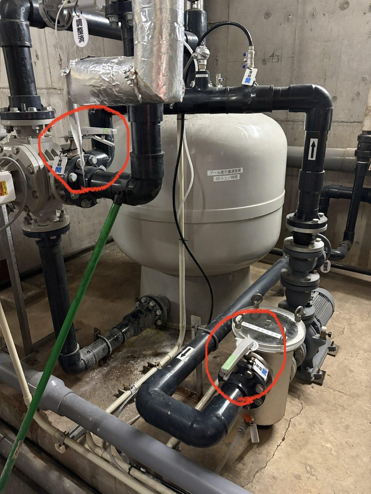
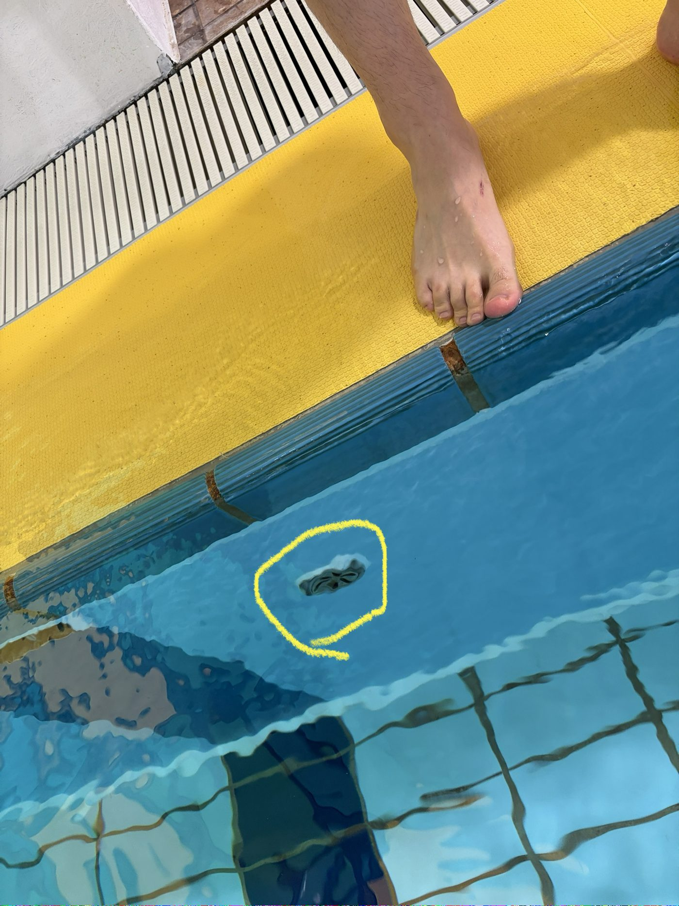

# 水抜き機械室操作

| 項目 | 内容 |
| --- | --- |
| 作業名 | 水抜き機械室操作 |
| 対象設備 | プールろ過系統（OF・底引）、補給水弁、排水バルブ |
| 排水開始 | 19:00 |
| 改訂日 | 2026-10-27 |

> 印刷用PDF：[水抜き機械室操作.pdf](水抜き機械室操作.pdf)

---

## 1. 目的

プールの水抜きにあたり、補給水の停止からろ過器の停止、ヘアーキャッチャーバルブの閉止、排水バルブの開放までを手順どおりに行う。

## 2. 安全上の注意

> ⚠️ **排水バルブを開ける前に、必ず「底引&nbsp;運転」を【切】にし、ヘアーキャッチャーの前後バルブを【閉】にしておくこと。**水位が下がると底引ポンプが自動停止する。
>
> ⚠️ バルブを閉じる前にろ過器が停止していることを確認する。運転中にバルブを閉じるとポンプに負荷がかかる。

---

## 3. 作業手順

### 手順① 補給水を止める

制御盤の「補給水弁（自動・閉・開）」スイッチを**「閉」**にする（写真の黄色丸）。
補給水を止めないと、排水しても水位が下がらない。

---

### 手順② 営業中に水位を下げる場合

左側の「OF&nbsp;運転（自動・切・手動）」スイッチを**「切」**にする（写真左の橙色丸）。
そのうえで「底引&nbsp;運転切替」を**「逆洗浄」**にし、随時 底引を逆洗して水位を下げる。

---

### 手順③ ヘアーキャッチャー 前後バルブ 閉

ろ過器を停止したら、ヘアーキャッチャーの**前後バルブを閉じる**。
前後2箇所が確実に閉じていることを確認する。

---

### 手順④ 底引側 ヘアーキャッチャー 前後バルブ 閉

底引ろ過装置側のヘアーキャッチャーも同様に閉じる。
こちらも前後2箇所が確実に閉じていることを確認する。

---

### 手順⑤ 排水バルブ 開（19:00）

**19:00** に排水バルブを**【開】**にする。
水位が写真の黄色丸の位置まで下がると**底引ポンプが自動停止する**。
そのため、開ける前に手順③④を必ず済ませる。

---

## 4. 作業完了後の確認

- [ ] 補給水が止まっている
- [ ] OF・底引のろ過器が停止している
- [ ] ヘアーキャッチャーの前後バルブが2系統とも閉じている
- [ ] 排水バルブが開いている
- [ ] 水位の下がり方を確認した

## 5. 実施記録

| 実施日 | 実施者 | 排水開始時刻 | 終了時の水位 | 特記事項 |
| --- | --- | --- | --- | --- |
|  |  |  |  |  |
